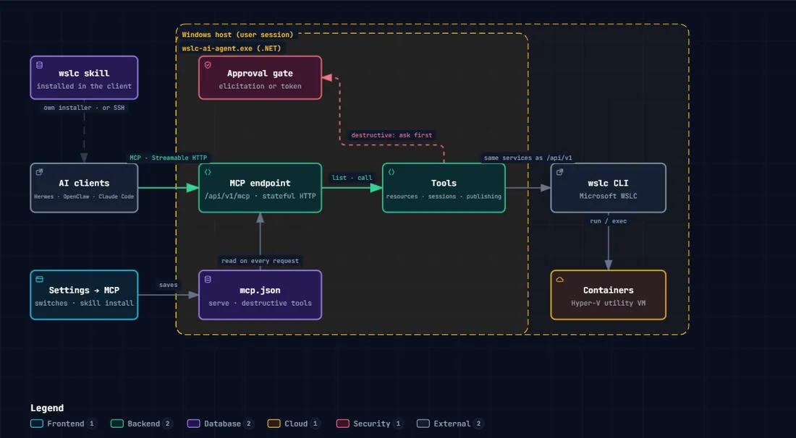
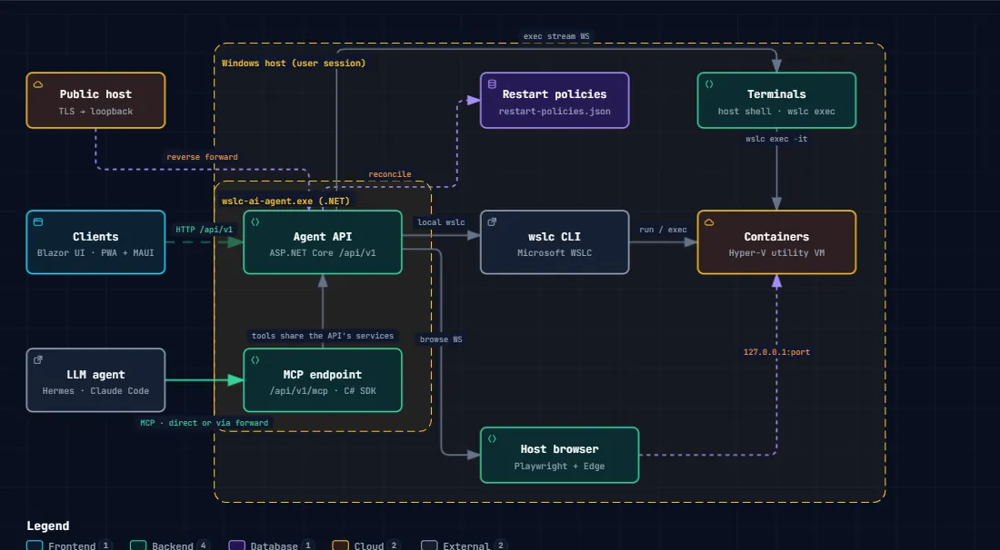

# WSLC AI Agent

A **local agent and MCP server for WSLC** (Windows Subsystem for Linux
Containers), with its skill included, so Claude, Hermes, OpenClaw and other
AI agents can operate your WSLC infrastructure: containers, images, volumes,
networks and sessions. Built for the age of AI agents, it also brings a web
dashboard and Windows and Android clients, to manage it all yourself from
anywhere. Destructive actions are off by default; switched on, each one
still asks your approval.

It is the small Windows process that sits next to `wslc`, talks to it for you,
and exposes what it knows over HTTP, in a browser, in native apps and through
the Model Context Protocol. Repository and namespaces are `wslc-agent`; the
products are **WSLC AI Agent** (the agent, `wslc-ai-agent.exe`) and
**WSLC AI Client** (the Windows and Android apps, `wslc-ai-client.exe`).

## The history of the project

<!-- The same text as docs/history.md: a change to the story is made in both. -->

### A Python dashboard (June 2026)

WSLC AI Agent began on 2026-06-30 as a small Python project, `wslc-dashboard`:
a simpler Docker Desktop for everyday use, for the containers WSL had just
learned to run with `wslc`. FastAPI and HTMX served a web page; the first day
brought a containers table with live stats and actions, and an Images page
that showed a pull's progress as it went.

<details>
<summary><b>Read the whole story</b>: SSH and Entra ID, an agent in the user's session, the rebuild in .NET, the dashboard, remote access, publishing, Compose and security</summary>
<dl><dd>

### Reaching `wslc` from somewhere else (July)

The dashboard ran in a Linux container of its own, so it had to reach `wslc`
on the Windows host. First through an HTTP proxy (2026-07-07), then over SSH,
set from the dashboard's Settings (2026-07-08). Sessions could be started
and stopped from the page, containers recreated, files browsed inside them
and a console opened in them; by 2026-07-14 it covered the whole `wslc`
command line of WSL 2.9.4.

Then the tests met the first real problem: authentication over SSH. What
OpenSSH starts is not the session of the user signed in at the machine, and
`wslc` keeps its sessions, images and containers per user, in that session.
Commands run over SSH were not the user's own: an image pull stopped at 0%,
or ended in `E_ACCESSDENIED`.

So we tried `runas`: SSH carried the connection, and `wslc` ran as the
signed-in user, in that user's session (mid-July). That brought the second
problem. The machine's owner signs in with a Microsoft Entra ID (Azure AD)
account, and OpenSSH would not take that principal. A local account took
over SSH, and `wslc` still ran as the Entra ID user through `runas`, trying
each form Windows might accept for the credentials, `DOMAIN\user`, the name
as given and the UPN `user@domain`, until one went through (end of July).

It worked, with two identities to keep in step and a bridge in the middle.

### An agent in the user's session (August)

On 2026-08-03 the design changed. More SSH was not the answer, and neither
was a Windows Service, which runs in session 0 and meets the same wall.
`wslc` had to run locally, as the user who owns the containers, in that
user's session. The dashboard became an agent with an API only, started by a
logon task of that user, with no administrator rights, and taking a token
from the clients on the network. SSH was retired for `wslc`, and that is
still what the agent is.

Ten days later, on 2026-08-13, .NET MAUI was chosen for native clients, and
the first Windows client connected to the agent's API.

### Rebuilt in .NET (September)

Through August and early September the Python agent grew: sign-in from the
internet, client packages served by the agent, a network map, and the plan
for an MCP server, so AI agents could use it too (2026-09-12).

When the time came to rebuild it all in .NET, the specification was written
first, from what the Python project had shown was needed:

- **One interface**, for the web, Windows and Android.
- **A dashboard** each user designs.
- **Alarms**, which became notifications.
- **Automatic updates**, of the agent and the clients.
- **MCP**, for AI agents.
- **Remote access**, from anywhere.
- **Files** and **transfers**.
- **Terminals**, the host's and every container's.
- **Publishing**.
- **Backups**.
- **Network map**.
- **Saved logins**.

On 2026-09-13 the rebuild began, in a new repository, `wslc-agent`: one
ASP.NET Core agent serving a Blazor interface and an MCP server, and one set
of Razor components for the web, the Windows app and the Android app. The
next day brought the installers, the per-user logon task and the Android
client; on 2026-09-18, the MCP skill for AI agents.

### Published (end of September)

On 2026-09-29 the project was published here as WSLC AI Agent, and
[1.0.0](https://github.com/Berpiztu/wslc-ai-agent/releases/tag/v1.0.0)
came out the next day: the agent, the web dashboard, the Windows and Android
clients and the MCP server. A release a day, or several, followed.

### The dashboard

The Home page is not a fixed screen: each user designs it, and it has had
work in every release since. An editor with:

- **Cards**, ready-made or built, and cards inside cards.
- **Objects**: readings, dials, charts, tables, events.
- **Pages**: System and User.
- **Views**: landscape and portrait.
- **Screens**: desktop and mobile, each opened its own way.
- **Layouts**: Grid and Fluid.
- **Zoom** and **fit**.
- **Groups**.
- **Preview**.
- **Undo**.
- **Drafts**, kept until saved.
- **History** of every saved version.
- **Alarms**, on every measure.
- **Defaults**, shipped with each release.
- **Storage** on the agent, for every client, or on the device.

### Remote access

Not only the WSLC machine is reached from anywhere, but its containers too:
their files, their consoles and their web pages, from a phone, another PC or
across the internet, for you and for your AI agents.

- **Trusted at the machine**, with a login from anywhere else: a user and a
  password, or an API token for scripts and AI agents (2026-09-16).
- **Files** in any container, image or volume of a remote machine: browse,
  edit, copy, upload and download, with the device's own Open and Save
  dialogs. Transfers belong to the agent: they keep going when the window
  closes, and every client sees them.
- **Terminals**: the host's shell and a shell in any container, in the
  browser or in the apps (2026-09-15); on a phone, a row of the keys its
  keyboard lacks, laid out as Termux (2026-10-06).
- **A container's web page**, even one not published: a browser runs on the
  agent's machine and its picture comes to you, with mouse, keyboard, touch
  and clipboard (2026-09-16).
- **No port opened at home**: a guide for reverse SSH tunnels to a VPS.

### Publishing

A container's port on a public HTTPS name, from its own form. The agent
hands it to its proxy, [wslc-published](plugins/wslc-published/README.md),
nginx and a login in one container, which serves it at once. The installer
offered to set it up from the first release (2026-09-29); on 2026-10-03
the proxy became a plugin of its own, with users per name.

Every published name has a login. An application with a login of its own is
let through; any other gets the proxy's, so nothing goes out to the world
open by mistake.

### Updates that wait for you

The agent updates itself, and it asks first. When a new version arrives, it
tells every client a minute before it starts, and every device that gets
its notifications, with **Cancel update** on the notification itself: any
of them can stop it. It waits for file transfers and backups to finish,
since an update would cut them, then installs, starts again, and the
clients offer their own new version next time they open.

### Compose (October)

`wslc` cannot run a Compose file yet; native support is tracked in
[microsoft/WSL#40948](https://github.com/microsoft/WSL/issues/40948). With
containers, images, volumes, networks and sessions in place, a group of
containers that start together was the next step. On 2026-10-10 Compose
files became projects in the web and the apps, and the same day
`wslc-compose` brought Compose's own command line, in
[1.5.0](https://github.com/Berpiztu/wslc-ai-agent/releases/tag/v1.5.0).

The first real test was humbling. Eight services built from two
Dockerfiles, no cache: Docker did it in 208 seconds, and we took about
1,100. Docker had seen that eight services from two Dockerfiles are two
images with eight names; we had built the same image four times, twice
over. Fixed before lunch, same file, same machine, same morning: 216
seconds, eight behind Docker
([the whole story](docs/features/wslc-compose.md#the-part-where-we-were-slow)).

Three days later a project could be built on another machine from the
sources on yours: the build context travels as a tar archive, and only the
files the agent lacks are sent. A project got its card on the dashboard,
its containers inside it, and a chart could follow a whole project.

### Security (October)

On 2026-10-19 two remote code execution vulnerabilities were published for
ASP.NET Core, which the agent is built on. The patch went out the same day,
and the project changed with it: a library with a known high or critical
vulnerability now stops every build, an audit checks both branches every
morning, and every build asks
[security-watch](https://github.com/Berpiztu/security-watch) first and sends
it its list of libraries after. A release goes out only with a list
security-watch has checked.

The same care then turned to the containers. Every image the agent builds
has its Python libraries checked against OSV.dev, read from the image's own
files without running anything in it, and one moderate or worse stops the
build. Then the check moved to every container: before it is made, by Run,
Create, an edit, an image update or a project's save, and before it starts.
The rule follows who can mend the image:

- **An image built here** is yours to mend: while it is vulnerable, no
  container of it is made or started. Build it again with the version the
  check names.
- **An image from a registry** is not: its containers always start, and are
  marked instead, the state chip saying CVE in yellow or in red, with what
  was found at the end of their logs. Whether it runs is yours to decide.
- **A container that runs** is never stopped by the check.

Each image's libraries and every vulnerability known for them are one click
away, from a container's, a project's or an image's menu, least severe
first.

`wslc` can still be used around the agent, and the agent now notices: a
project with a service whose container is gone, and another container
holding its name, is marked, and answered as an update would be, so nothing
of the project sends its work to a container that is not its own. A project
saved from another Compose file asks first.

### Following WSL

From 2026-10-19 the project has two branches: `main` for the official WSL
release, and `develop`, which follows the newest WSL preview and publishes
its own previews, the first of them 1.6.4, for WSL 3.0.4.


</dd></dl>
</details>

## Features

- **New: Compose on WSLC, with the `wslc-compose` command. `wslc` cannot
  run a Compose file yet; the agent runs yours today, from the command line
  and from the web and the apps.**
  `wslc-compose up -d`: Compose's own command line (`config`, `build`, `up`,
  `down`, `start`, `stop`, `restart`, `logs`, `ps`, `ls`), installed with
  the agent and on your `PATH`. The same file opens in the web interface and
  the clients as a project: checked line by line before anything runs
  (taken, converted or not supported), then started, stopped and watched as
  one group of containers, with one log
  ([docs/compose/wslc-compose.md](docs/compose/wslc-compose.md)). A first
  project in ten minutes: [the counter](docs/compose/examples/counter/README.md).
- **New: build on another machine, from the sources on yours (WSL 3.0.3).**
  `wslc-compose --agent https://server.example.com --token … up -d --build` packs the
  build context as a tar archive, sends it to the agent, and the agent
  builds it there with `wslc build -`, which reads a context from its
  standard input since WSL 3.0.3. Only the files the agent lacks travel: a
  Dockerfile changed in a folder of fifty megabytes is sent as a Dockerfile.
  The Compose window does the same from a folder of your device.
- **New: every image the agent builds is checked for vulnerabilities.**
  Built from a Compose project or with Build image, an image has its Python
  libraries read in the image itself and checked against the public
  vulnerability database, OSV.dev, before any container is made from it. A
  library with a vulnerability of moderate severity or worse stops the
  build, naming the version that fixes it; Settings → Security sets whether
  it stops, only warns, or is off.
- **An MCP agent for WSLC, skill included for Claude, Hermes, OpenClaw,
  etc.**: 55 tools, the destructive ones off by default and asking your
  approval once switched on, and a skill installed with one click. One Windows program beside `wslc` that runs in
  the background of your Windows session, goes on with the browser and the
  apps closed, and serves the web interface, the clients
  and a REST API too. Per user, no administrator rights.
- **Easy container management with WSLC, MCP and skills**: containers,
  images, volumes, networks and sessions from one place; paste a `docker run`
  line to fill the form; live stats, a network map, restart policies kept by
  the agent. Or just tell your AI agent (below).
- **Manage from anywhere, you or your AI agents**: Claude, Hermes,
  OpenClaw, etc. connect over MCP from wherever they run, and so do you from
  a phone or across the internet. Not only the WSLC machine but its
  containers: open a console on the
  host or in any container, open a container's web page even when it is not
  published, and publish it on a public HTTPS name through the agent's own
  proxy, with a login of its own in front of any application that has none
  ([wslc-published](plugins/wslc-published/README.md), image
  `ghcr.io/berpiztu/wslc-published`).
- **Files** inside containers, images and volumes, with transfers that keep
  running when you leave.
- **Logs**: the agent's own, and every `wslc` command it ran.
- **A dashboard you design yourself**: live objects dragged onto a grid, a
  System and a User page, a landscape and a portrait view, kept on the agent
  for every client or on the device, alarms, and a fit for any screen.
- **Notifications** on Windows and Android.
- **Every client, one interface**: browser, Windows app, Android app and tray
  icon; several clients per agent, several agents per client.
- A **self-updating** agent and clients.

### Just tell your AI agent

Everything the app does, your AI agent (Claude, Hermes, OpenClaw, etc.) can
do too, through the agent's MCP server and its skill.

[](https://berpiztu.github.io/wslc-ai-agent/architecture/wslc-mcp.html)

▶ **[Explore it interactive](https://berpiztu.github.io/wslc-ai-agent/architecture/wslc-mcp.html)**

Ask in your own words:

```text
List all containers with their state and ports
Run this as is: docker run -d --name web -p 8080:80 nginx:latest
Show me the last 20 log lines of the web container
Show me the live CPU and memory of the database container
Pull alpine:latest and let me know when it finishes
Show me the network topology
Publish port 80 of the web container on web.example.com
Clean up the images that are not used
```

**Destructive actions are off by default**: removing, pruning, killing,
running a command inside a container, publishing and stopping a session are
not even offered to the AI agent until you switch them on in Settings → MCP
server. Switched on, each one still waits for your yes: the AI agent shows
what it is about to do and asks first. The last two examples above need
them on. More examples:
[docs/features.md](docs/features.md#or-just-tell-your-ai-agent).

Every feature, explained: [docs/features.md](docs/features.md).

## Architecture

[](https://berpiztu.github.io/wslc-ai-agent/architecture/wslc-overview.html)

▶ **[Explore it interactive](https://berpiztu.github.io/wslc-ai-agent/architecture/wslc-overview.html)**:
zoom, search, follow a route, light or dark. More:
[terminals](https://berpiztu.github.io/wslc-ai-agent/architecture/wslc-terminal.html),
[a container's page](https://berpiztu.github.io/wslc-ai-agent/architecture/wslc-networks.html),
[MCP](https://berpiztu.github.io/wslc-ai-agent/architecture/wslc-mcp.html).

The agent in the middle is the only thing that runs `wslc`: the clients call
its API, AI agents its MCP endpoint, and a public host reaches it through a
reverse forward. The same diagrams open from any screen of the app (the
architecture button).

| Project | Role |
|---|---|
| `WslcAgent.Server` | ASP.NET Core agent: runs `wslc`, exposes `/api/v1`, serves the UI, hosts the MCP endpoint. Ships as `wslc-ai-agent.exe`. |
| `WslcAgent.UI` | The one user interface: Razor components on [MudBlazor](https://mudblazor.com/). |
| `WslcAgent.Web` | Blazor WebAssembly host of the UI, served by the agent, installable as a PWA. |
| `WslcAgent.App` | .NET MAUI Blazor Hybrid host of the UI for Windows and Android (`wslc-ai-client.exe`, `ai.berpiztu.wslcaiagent`). |
| `WslcAgent.ApiClient` | Contracts and typed client for `/api/v1`, shared by every host. |
| `WslcAgent.Mcp` | MCP tools (official C# SDK), hosted by the server. |
| `Berpiztu.Dashboard` | The dashboard and its designer, a Razor class library on MudBlazor that knows nothing of WSLC. |
| `WslcAgent.Tray` | The agent's icon beside the clock (`wslc-ai-agent-tray.exe`): a click opens its page in the browser; its menu and its notifications. |
| `WslcAgent.Toasts` | The agent's notifications as Windows toasts, shared by the tray and the Windows client. |
| `Berpiztu.Wslc.Compose` | Compose files from the command line (`wslc-compose.exe`): Compose's own commands, answered by the agent. Installed with it. |

One UI, one language, one API contract.

## Built with

- [.NET 10](https://dotnet.microsoft.com/) and ASP.NET Core minimal APIs
- [Blazor WebAssembly](https://learn.microsoft.com/aspnet/core/blazor/) for the UI
- [MudBlazor](https://mudblazor.com/) as the component library and look
- [MCP C# SDK](https://github.com/modelcontextprotocol/csharp-sdk) for the MCP server
- [.NET MAUI](https://learn.microsoft.com/dotnet/maui/) Blazor Hybrid for the native apps
- [WiX Toolset](https://wixtoolset.org/) for the Windows installers
- [xterm.js](https://xtermjs.org/) for the terminals

## Quick start

Needs Windows 11 and **WSLC**, generally available since WSL 3.0.1: install
the [latest WSL release](https://github.com/microsoft/WSL/releases/latest). The agent works with 3.0.0 or later;
building on an agent from the sources of another machine needs WSL 3.0.3 or
later on the agent's machine.

Two ways in:

- **[Install it](#install-it)**: download the installers of the latest
  release and use the agent. Nothing to build.
- **[Build it yourself](#build-it-yourself)**: clone the repository, build and
  run it from source, to change it or to contribute.

### Install it

> [!WARNING]
> **Our installers are not digitally signed.** We recommend building your own
> ([Build it yourself](#build-it-yourself)): you then run exactly the code you
> read. For convenience we publish ready-made installers too, and Windows and
> your browser will warn about them because nobody signed them:
>
> - **The browser**, when downloading ("isn't commonly downloaded" or similar):
>   open the download's **…** menu → **Keep** → **Show more** → **Keep anyway**.
> - **Windows**, when opening it ("Windows protected your PC"): **More info** →
>   **Run anyway**.
>
> The PowerShell download below avoids the browser's warning.

**1. Download and install the agent**, in one PowerShell line: it downloads
`wslc-ai-agent.msi` from the latest release into your Downloads folder and
opens it ([install.ps1](install.ps1)).

```powershell
irm https://berpiztu.github.io/wslc-ai-agent/install.ps1 | iex
```

It installs for your user only, with no administrator rights; its wizard asks
for the address and port the agent listens on (`127.0.0.1` and `8069` unless
you change them) and for its package folder ([How to update](#how-to-update)).
If Windows warns that the installer is from an unknown publisher: **More info
→ Run anyway**. Once installed, it leaves the three installers in the agent's
package folder (the agent's, and the Windows and Android clients', so anyone
opening the agent's web page can download the clients from there); asks whether to install the Windows client on this
machine too; and asks whether to create the publishing
container, the proxy that puts a container on a public HTTPS name with a
login in front (`ghcr.io/berpiztu/wslc-published`, downloaded by WSLC itself;
default: no); its domain is then set in **Settings → Publish**. Prefer the browser? Download it from the
[latest release](https://github.com/Berpiztu/wslc-ai-agent/releases/latest).

**2. Open it.** The agent starts at once, and at every logon from then on;
its icon sits beside the clock. All is well when http://127.0.0.1:8069 opens
the dashboard:

```powershell
Start-Process http://127.0.0.1:8069
```

**3. Optional: the clients and your AI assistant.**

- **Windows client**, downloaded and installed the same way:

```powershell
irm https://berpiztu.github.io/wslc-ai-agent/install-client.ps1 | iex
```

- **Android client**: `wslc-ai-client.apk`, from the same
  [release](https://github.com/Berpiztu/wslc-ai-agent/releases/latest), opened
  on the phone. Either client connects to the agent on the same machine unless
  told another address, and changes it in **Settings → This client**.
- **Claude Code** (or any MCP client) reaches the agent's tools with:

```powershell
claude mcp add --transport http wslc-agent http://127.0.0.1:8069/api/v1/mcp
```

To reach the agent from another machine or from the internet:
[docs/developer/remote-access.md](docs/developer/remote-access.md).

### Build it yourself

Run each line in PowerShell, one at a time, and check what it shows before
going on to the next.

**1. Let PowerShell run the scripts** (once per user; answer `Y`).

```powershell
Set-ExecutionPolicy -Scope CurrentUser RemoteSigned
```

**2. Clone the repository.** No git yet? Install it first, then open a new
terminal:

```powershell
winget install --id Git.Git -e
```

Then clone:

```powershell
git clone https://github.com/berpiztu/wslc-ai-agent.git
```

**3. Go into it.**

```powershell
cd wslc-ai-agent
```

Downloaded the ZIP from GitHub instead of cloning? Windows marks every file
of it as coming from the internet, and PowerShell refuses to run the scripts
("is not digitally signed"). Unblock them once, from the folder you unzipped:

```powershell
Get-ChildItem -Recurse | Unblock-File
```

**4. Check what this machine needs.** It installs nothing. All is well when
the last line is green: **Ready to build**, and you can go on to step 5.
Otherwise, under every missing piece, it prints the command that installs
it and the section of
[docs/developer/prerequisites.md](docs/developer/prerequisites.md) that
explains it (VS Code, Visual Studio or no IDE).

```powershell
.\check-prereqs.ps1
```

**Install what is missing, all at once.** Windows asks once for
administrator rights, and it goes on in an administrator window of its own:
the .NET SDK and its workloads, the JDK, the Android SDK, WSL, in the right
order.

```powershell
.\install-prereqs.ps1
```

When it ends, **close every terminal and VS Code and open them again** (a
terminal only sees what was installed before it started; restart Windows
if it says so), and run `.\check-prereqs.ps1` again. You can also run each
printed command yourself, one at a time.

**5. Check the private files.** They are optional (the signing key, push
notifications) and a fresh clone has none. All is well when the last line is
green: **Nothing broken**; `[absent]` only switches off what it names.

```powershell
.\check-private.ps1
```

**6. Build and test**, as CI does. All is well when the tests pass and it
ends in **Done.** The first run downloads the packages and takes a few
minutes.

```powershell
.\build.ps1
```

**7. Run the agent.** All is well when http://127.0.0.1:8070 opens the
dashboard. `Ctrl+C` stops it.

```powershell
.\start-agent.ps1
```

Every step, what it shows and what to do when it shows something else:
[docs/developer/getting-started.md](docs/developer/getting-started.md).
The signing key and the Firebase files, when you want signed APKs or push
notifications: [docs/developer/private-files.md](docs/developer/private-files.md).

## How to update

**Installed a release?** The same line that installs it updates it:

```powershell
irm https://berpiztu.github.io/wslc-ai-agent/install.ps1 | iex
```

With the agent already installed, it compares its version with the latest
release. When there is a newer one, it downloads the three installers into the
agent's **package folder** and has the agent install its own at once: the
agent waits for any transfer in progress and starts again as the new version
in a minute or two, and its clients then offer theirs. When there is none, it
says so and changes nothing.

The agent updates itself, and offers its clients their updates, from that
package folder: the line above fills it, and so can you by hand.

- **By hand**: copy the new `wslc-ai-agent.msi`, `wslc-ai-client.msi` and
  `wslc-ai-client.apk` into the package folder (`C:\Berpiztu\wslc-ai-agent`
  unless you chose another when installing); with **Auto update** on
  (Settings → Update) the agent installs itself, or press **Update now**.
- **Built it yourself?** The agent takes its updates from your clone's
  `dist`, where the build scripts put them. To keep it from updating itself
  every time you build, turn **Auto update** off in Settings → Update.

The package folder can be changed in Settings → Update at any time. How it
all works, step by step: [docs/updating.md](docs/updating.md).

## Scripts

All scripts live in the repository root and work from any current directory.

| Script | What it does |
|---|---|
| `install.ps1` | Install the agent from the latest release, or update it when it is installed already. What the Quick start and How to update run, through GitHub Pages, with `irm ... \| iex`. |
| `install-client.ps1` | Install the Windows client from the latest release: `install.ps1 -Client`, in a line as short as the agent's. |
| `check-prereqs.ps1` | What the machine needs to build, test, run and package, and the command that installs what is missing. Changes nothing. |
| `install-prereqs.ps1` | Install everything `check-prereqs.ps1` finds missing, in order, after one administrator prompt. |
| `check-private.ps1` | The private files this checkout has and what each enables, without printing a secret. |
| `deploy-release.ps1` | Publish a release: raise the repository's version above every build, commit, tag and push; GitHub Actions builds the three installers and publishes the release. `-Local -Publish` builds and uploads them from this machine instead ([releasing.md](docs/developer/releasing.md)). |
| `start-sandbox.ps1` | A clean Windows in Windows Sandbox, to try the Quick start as a new user ([clean-machine-test.md](docs/developer/clean-machine-test.md)). |
| `build.ps1` | Restore, build, test: what CI runs. `-NoClient` leaves the MAUI client out, as CI's quick build does. |
| `start-agent.ps1` | Build and run the agent in Development on http://127.0.0.1:8070. `-Port`, `-NoBuild`, `-Watch` (dotnet watch, hot reload on save). |
| `debug-client.ps1` | Debug build of the Windows client and launch it against `-AgentUrl` (default the local agent). |
| `debug-android.ps1` | Debug build of the Android client, deploy to an emulator or phone and launch it against `-AgentUrl` (default `http://10.0.2.2:8070/`, the host as seen from the emulator). |
| `debug-phone.ps1` | `debug-android.ps1` aimed at the phone on the USB cable: built for its architecture, and launched against the PC's agent through the cable. |
| `build-agent-installer.ps1` | `dist\wslc-ai-agent.msi`: self-contained agent with the UI inside. |
| `build-client-installer.ps1` | `dist\wslc-ai-client.msi`: the Windows client. |
| `build-client-apk.ps1` | `dist\wslc-ai-client.apk`, arm64-v8a, signed. `build-client-apk-full.ps1` bundles every ABI. |
| `build-wslc-compose.ps1` | `dist\wslc-compose.exe`: the Compose command as one file with its runtime inside, for a machine with no agent of its own. The agent's installer carries its own copy. |

The three installer scripts count every build as a fourth part of the last
release's version (`1.0.27.1`, `1.0.27.2`…), in `private\version.props` (never
tracked), so each installer is newer than the last and a build changes no
tracked file; `-NoBump` builds the same version again. The version in the
repository is the last release's, changed only when one is published: a
patch takes the next fourth part after every build (`1.0.27.3`), and any
other version is chosen ([releasing.md](docs/developer/releasing.md#version-numbers)).

Without the scripts: `dotnet build`, `dotnet test`,
`dotnet run --project src/WslcAgent.Server` from the repository root. A
Production run must come from `dotnet publish` (or the MSI); an unpublished
Production run cannot serve the UI.

`GET /api/v1/health` reports the version; the MCP endpoint is `/api/v1/mcp`
(Streamable HTTP). To try it from Claude Code:

```powershell
claude mcp add --transport http wslc-agent http://127.0.0.1:8069/api/v1/mcp
```

The agent installer asks for the bind address and port (defaults 127.0.0.1
and 8069; development runs on 8070). Installer settings are also MSI properties, `WSLC_BINDHOST` and
`WSLC_AGENTPORT` for the agent and `WSLC_AGENTURL` for the client, e.g.
`msiexec /i dist\wslc-ai-agent.msi WSLC_AGENTPORT=8069`. The agent MSI
registers a per-user logon task that starts the agent right away and at every
logon, because wslc only works inside a user session. Android APKs are
signed with a key kept outside the repository, in `private/`; see
[docs/developer/private-files.md](docs/developer/private-files.md).

## Contributing

Issues and pull requests are welcome: [CONTRIBUTING.md](CONTRIBUTING.md) says
how to build it, what a pull request needs and the rules the code keeps, and
[AGENTS.md](AGENTS.md) gives the same rules to AI coding agents. Security
problems go privately, through [SECURITY.md](SECURITY.md). Everyone follows
the [code of conduct](CODE_OF_CONDUCT.md).

## License

[MIT](LICENSE). Copyright (c) 2026 Berpiztu. Third-party components and
their licenses are listed in [THIRD-PARTY-NOTICES.md](THIRD-PARTY-NOTICES.md).

WSLC AI Agent is built by [Berpiztu](https://github.com/Berpiztu), a team
that builds AI agents and the tools they work with, and the team behind
[Virtus](https://github.com/berpiztu/virtus). It began on 2026-06-30 as a
Python dashboard for `wslc` and was rebuilt in .NET before it was published:
[the history of the project](#the-history-of-the-project).

Special thanks to Alex, the AI agent who helped me create this project.
