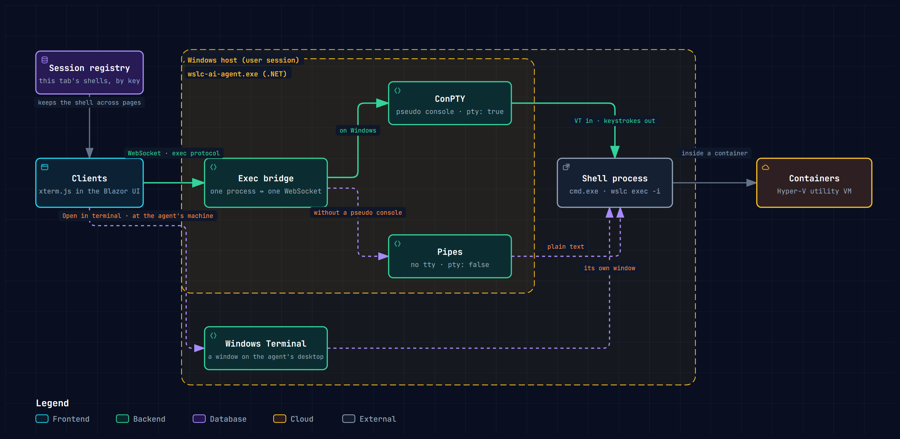
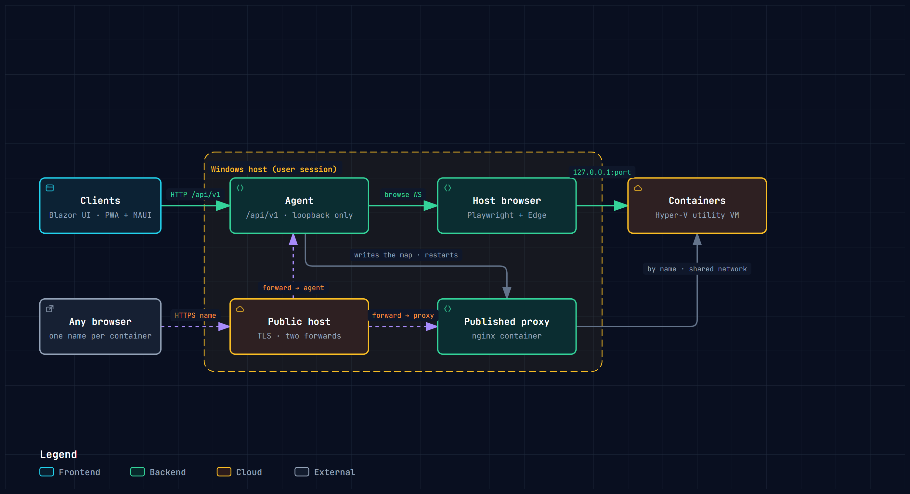

# Features

Everything WSLC AI Agent does, first at a glance, then area by area.
WSLC AI Agent is made by [Berpiztu](https://github.com/Berpiztu), which builds
AI agents and the tools they work with: it is made for you and for your AI
agents alike.

## At a glance

- **An MCP agent for WSLC, skill included for Claude, Hermes, OpenClaw, etc.**
  - 55 MCP tools: your AI assistant runs your containers; destructive actions are off by default, and once switched on each one asks your approval
  - Its skill, which teaches the assistant WSLC, installed with one click into Claude Code, Hermes Agent or OpenClaw
  - A small Windows program that sits next to `wslc`, Microsoft's container CLI, and runs it for you
  - Runs in the background of your Windows session: close the browser and the apps, and its jobs, restart policies, alarms and notifications go on
  - Serves everything itself: the web interface, the native clients, a REST API (`/api/v1`) and an MCP server
  - Installed per user, with no administrator rights; an icon beside the clock
- **Easy container management with WSLC, MCP and skills**, all of it from one place, or from your AI agent in your own words
  - "Run this as is: docker run -d --name web -p 8080:80 nginx:latest", "Show me the last 20 log lines of the web container", "Publish port 80 of the web container on web.example.com"
  - Containers, images, volumes, networks and sessions, as lists or cards
  - Run, create, edit, recreate, start, stop, restart, kill, remove, back up, export
  - Paste a `docker run` or `wslc run` line and get the form filled in, checked before it runs
  - Pull, build, tag, push, save, import and load images; create and prune everything
  - Live stats, a live network map, per-session disk usage and VHDX compaction
  - Restart policies enforced by the agent itself
- **Manage from anywhere, you or your AI agents**: not only the WSLC machine, its containers too
  - Your AI agents (Claude, Hermes, OpenClaw, etc.) connect from wherever they run, over MCP with an API token, and manage it as you would
  - Reach the agent from a phone, another PC or the internet: login or API token, SSH tunnels to a VPS
  - Consoles: the host's terminal and a shell in any container, in the browser
  - Open a container's web page even when it is not published, through a browser streamed from the agent's machine
  - Publish a container's port on a public HTTPS name through a built-in nginx proxy
- **A file browser inside containers, images and volumes**, with transfers that keep running when you leave
- **Logs**: the agent's own log and every `wslc` command it ran, filterable, live
- **A dashboard you design yourself**
  - Drag, resize and group live objects on a grid: readings, dials, charts, logs, containers, images, volumes, networks
  - Two pages (System and User), each with a landscape and a portrait layout that follows the screen
  - Kept on the server for every client, or on each device, and copied between them
  - Drafts that survive a power cut; Save and Discard
  - Alarms with thresholds that turn a card red and appear in a status bar on every screen
  - Zoom and five ways to fit any screen: Fit, Fill, Width, Stretch, Fluid
- **Notifications** on Windows and Android: thresholds, stopped containers, sessions down, jobs done, updates
- **Every client, one UI**: web browser (also as an installable PWA), Windows app, Android app, and a tray icon
- **Multi-client and multi-agent**: several clients on one agent share jobs and state; one client knows several agents
- **Self-updating**: the agent and its clients update from one folder, with a countdown anyone can cancel
- **Personalisable**: dark and light themes, page zoom, table or cards per list, and the look of every control

## The MCP agent

WSLC AI Agent is one Windows program, `wslc-ai-agent.exe`, that runs beside
`wslc` in your user session and does the work: every screen, client and
AI assistant asks the agent, and the agent runs `wslc`. It is an MCP server
from the start, with its skill included for Claude, Hermes, OpenClaw, etc.

### MCP and AI assistants

- **An MCP server** in the agent (`/api/v1/mcp`) with 55 tools: containers,
  images, volumes, networks, sessions, publishing, notifications, logs and
  the machine's state, and the paste of a `docker run` line.
- **Destructive tools off by default**: removing, pruning, killing, running a
  command inside a container, publishing and stopping a session are not even
  offered to the assistant until you switch them on in Settings → MCP server.
- **Switched on, they ask first**: a yes or no in the assistant where it
  supports it, a confirmation step otherwise.
- **A skill** that teaches the assistant how to work with WSLC, served by the
  agent itself and **installed with one click** into Claude Code, Hermes Agent
  or OpenClaw, on this machine or another over SSH. Settings > MCP says how to
  update it: the same install after the agent is updated, and for Hermes the
  command that registers the server again so its new tools are enabled.
- Setup guides and ready configurations for each assistant.
- **Architecture diagrams** of the agent, the terminal, the network and MCP,
  one click away on every screen.

### The agent

- **In the background of your Windows session**: close the browser and the
  apps and whatever it began goes on: runs, pulls, builds, transfers,
  backups, updates.
- **It keeps watch**: it brings containers back by their restart policy when
  it starts and when a session starts, and watches the host and the
  containers for the alarms and notifications below.
- **It serves everything**: the web interface, the Windows and Android
  clients, the REST API `/api/v1` and the MCP server `/api/v1/mcp`, all on
  one address and port (`127.0.0.1:8069` unless you choose another).
- **Per user, no administrator rights**: installed for your user alone, as
  `wslc` works inside a user session; its icon beside the clock opens its own
  page, with the System card over its log.
- **Updates itself** from a folder you choose (see [Updates](#updates)).

## Easy container management with WSLC, MCP and skills

Everything `wslc` does, without typing it: lists that refresh themselves,
forms that check what you typed before it runs, and every action one click
away, in a table or as cards.

### Or just tell your AI agent

Everything below can also be done from the AI agent you prefer (Claude,
Hermes, OpenClaw, etc.) through the agent's MCP server and its skill, simply
by asking in your own words. For example:

```text
Check the health of the WSLC server and tell me which wslc version it has
List all containers with their state and ports
Show me the last 20 log lines of the web container
Show me the live CPU and memory of the database container
Run this as is: docker run -d --name web -p 8080:80 nginx:latest
Prepare without starting: docker create --name store -p 9000:9000 minio/minio server /data
Pull alpine:latest and let me know when it finishes
Create a volume called site-html and run nginx:latest on port 8081 with it mounted at /usr/share/nginx/html
What is in /usr/share/nginx/html inside the web container?
Show me the processes running inside the web container
Set the restart policy of the web container to unless-stopped
Create a network called backend and connect the web container to it
Show me the network topology
Publish port 80 of the web container on web.example.com
Which session is selected and how much space does the store take?
What wslc commands has the agent run in the last few minutes?
Clean up the images that are not used
```

Destructive actions (removing, pruning, killing, running a command inside a
container, publishing, stopping a session) are off by default: the AI agent
is not even offered them until you switch them on in Settings → MCP server.
Switched on, each one waits for your yes: the AI agent shows what it is about
to do and asks first. Of the examples above, looking inside a container,
publishing and cleaning up need them on.

### Containers

- **List** with state, image, ports, CPU, memory, disk, id and restart
  policy; totals of CPU and memory; search; show only running ones; select
  several to start, stop or remove.
- **Run and create** from one form: image, name, ports, volumes and bind
  mounts, environment, networks with static addresses, entrypoint, command,
  working folder, user, restart policy, memory and CPU limits, health check,
  host and domain names, DNS, labels, tmpfs mounts, shm size, ulimits and
  stop signal. What `wslc` takes and its inspect does not say back, the
  agent keeps on the container itself, so editing one never loses it.
  - **Paste a command**: a `docker run` or `wslc run` line, even across
    several lines, fills the form; flags it cannot use are named, and so is
    one WSLC does not need: `--add-host=host.docker.internal:host-gateway`,
    since a container reaches the host by that name, and by
    `host.wslc.internal`, with no flag.
  - **What the image sets, shown before it runs**: once the image is known
    (a paste, the picker, a loaded file, a name typed), the form shows the
    variables, command, entrypoint, working folder, user and health check
    the image itself carries, in the fields left empty, to change before the
    container is made; what the form already says wins. An image that is
    not on the machine has to be pulled for that: the form asks first, and
    shows the pull as the lists do, in the window's title beside Close: a
    ring with its percentage, and beside it its output and its cancel.
  - **A Compose file**: the **Compose** verb opens a window built as the
    Run form is. The file is given one of two ways, a field each: **Open
    Compose file**, a file of the server's disk, whose button leaves the
    file's path there, or a path is typed (the button is a menu that asks
    where the file is: **From the server**, a picker that shows the
    server's disk and its Compose files, or **From this device**, the
    device's own Open dialog, for whoever has the file on the machine in
    front of them and wants its containers on a server somewhere else);
    and **Paste
    Compose**, where the Compose file itself is pasted, the one line
    showing its first and its arrow opening it whole over the window, to
    read and change. From another device than the agent's, a file of that
    device is loaded with the rail's **Load**, and comes as a paste does:
    its text, without the folder it was in. Once
    there is a file, **Context** is asked for under it: the folder its
    relative paths, its `build` and its `env_file` start from, which the
    file does not say. It is the file's own folder when the file was opened
    or its path pasted, and can be typed or picked. Its ⋮ asks where it is:
    **From the server**, a folder of the server's disk; or **From this
    device**, the folder the file is in on the machine in front of you,
    when the agent is on another one (the browser's own Select folder
    dialog where it has one, which reads of the folder only what the
    context's `.dockerignore` does not leave out). The images are then
    built on the server from that folder, sent when the project is saved
    or run (only the files the server lacks: a change travels as what changed). The
    folder is read before the question a save asks, which takes seconds,
    and sent after the yes with the window already closed, as the save
    itself goes on: the title bar's line and the transfers list say how
    far it has got, and nobody sits watching ten thousand files go, while what the file
    mounts, its `.env` and its `env_file` stay the server's, at the same
    path: the context is one folder, the same on both machines. A browser
    hands over a folder and not where it is, so loading a file of
    the device asks for things in one order, always the same: a small
    window for the full path of the folder the file is in, which is the
    context; and then the browser's own file chooser, for the file.
    Nothing is guessed or remembered. The folder itself is asked of the
    browser later, and only when a save has images to build from it, with
    a window that says why first. Beside
    it, **Check Compose file** reads the file: nothing is read before it
    is pressed. Under
    it the file is shown as the tree it is, its services, networks and
    volumes as branches to open and close, and on each branch's line
    what the agent makes of it: taken as written, converted (and into
    what: a relative path made whole, a volume under the project's name, a
    folder with a Windows link inside that the file mounts over taken as
    its entries, a mount each, and the link from its real folder, since WSLC
    does not follow a junction),
    or not supported (and why), so nothing the file asks for is dropped
    unseen. A branch is drawn in the colour of the worst line in it,
    however deep: one line not supported makes its branch red, and every
    branch over it, so a closed branch never reads as all well. A network
    or a volume the file names as `external` and the machine does not have
    is said on its line, and Save and Run then stop before anything is
    made, in a window that names it: the project does not create what is
    external to it. On the line of **Context** and **Check Compose file**,
    **Variables** holds the file's parameters, every `${NAME}` it asks for
    with the value it was read as, to set before it is saved, and
    **Profiles** the profiles to take the services of: its ⋮ lists the
    file's own profiles to tick, and a service the file keeps behind a
    profile is left out unless one of its profiles is ticked. **Services**
    is the same for the services themselves: tick some and only they are
    taken, with the ones they depend on, whatever the profiles say (what
    `up web` is at a terminal); tick none and the whole file is. Both are
    kept with the project, and its **Start** goes by them: what was saved
    is what comes up again, and a container of the project that was left
    out of that save stays as it is. The rail holds the Run form's two verbs: **Save** creates the project
    (its networks and volumes, the images it builds, a container a service)
    and leaves it stopped, **Run** also starts it, in the order the services
    depend on each other. Both say first what they are about to do, and then
    the window closes: the agent does the work, each container shows in the
    Containers list on its way, with its progress, and the title bar says
    how the project goes. The project is a row of that list too while it is
    saved, under its own name: how far it has got, its cancel, and its log,
    every step and what the builds print, in the window and with the
    colours and the rail of a container's logs. One that fails keeps its row and
    its log until it is dismissed. A project stays in the list as a
    group: one row with its name, how many of its containers run and their
    CPU and memory share added up, whose **+** opens its containers' rows
    under it (a project of one container shows it always, and has no **+**);
    in cards, its own card followed by its containers' cards, in
    the same cells as any other card, with the CPU and the memory of its
    containers added up as two dials, where a container's card has its own; a project always begins a row, and
    so does the card after its last one, so two projects never share a row. The project's own row and card are
    named `NAME-compose` and carry a soft tertiary tone (the whole row, the
    card's body), which tell them from a container's at a glance. A line runs round them as one, round
    its rows in the table as round its cards, green
    with every container running, blue with none, and striped in both with
    some; while something is being done to the project the line is striped
    and its card's header goes from the stopped tone to the running one
    and back, as do the cards of the containers a verb has not got to yet,
    the one whose turn it is turning its ring instead. A restart of the
    project is of the containers that run: one left stopped stays so. Its own
    verbs start, stop and restart its containers in the order its services
    start in, one at a time: the group opens, the container it is on
    shows it is working and the project how far it has got. A stop reads
    the other way: the project's bar and ring begin whole and run down
    as its containers go, the bar of the container being stopped
    moves from right to left, and its ring turns backwards. A container of
    a project is not started, by its own verb either, while a service its
    own depends on is not running, nor restarted, which a window of its
    own says, naming what has to be started first; stopping one that
    others of the project depend on says which they are and asks, then
    stops them first; and removing one warns that they will not be able
    to work without it. A container's own verb shows its project working
    with it, and each container shows as it is the moment its turn is
    over. Its **Logs** are its containers' as one, in the window a
    container's logs open in: what each wrote, in the order it was written,
    each line said by its container. Its other verbs open its Compose file in this same window, and remove the
    project (its volumes only when asked about them apart). They are laid
    out as a container's: start or stop, restart, a **⋮** menu (the Compose
    file, its logs, and its text copied to the clipboard) and remove; a card
    has the Compose file and the logs as buttons of their own at its left end. Containers on
    their own stand beside the groups as before; sorted by a column, the
    list is every container in that order, without groups. On a
    project that exists they apply the file to it: a service that did not
    change is left alone, one that did is recreated (rehearsed first, the
    old one kept if the new one does not start), and so is one whose image
    was built again or pulled anew since its container was made, so new
    code runs after a build; a new one is created, and a
    container whose service left the file is removed only after asking. A
    container of a project changed by hand is put back as the file says by
    the next save, which names it apart before it does, as editing it warns
    too; the names it is published on are kept. A container that could
    not start (its port is taken) is left made and stopped, its card's body
    in red with why, and its logs end with that same line (the card of a
    container that did start and whose process then ended with an error is
    red too, `Exited (1)`; one that was stopped is not, whatever code the
    stop left). The project says it on itself, since folded its containers
    are out of sight: its card's body and its row turn red while any of its
    containers has failed, with their names in red in its list and why on
    each. And its project
    shows it too, whoever asked for the start (this screen, the command
    line, another device): its ring stays in red at how many of its
    containers run (one of two: 50 %) until its cross lets the failure go,
    for every client
    ([how the agent does it](compose/emulate.md)). The same from a terminal:
    **`wslc-compose`**, installed with the agent and on the `PATH`, takes
    Compose's own commands (`build`, `up`, `down`, `start`, `stop`,
    `restart`, `logs`, `ps`, `ls`, `config`) and asks this machine's agent,
    with no login, in colour on a terminal; an `up` without `-d` stays and
    shows the containers' logs as they are written
    ([wslc-compose](compose/wslc-compose.md)).
  - **Checked before it runs**: names in use, ports taken, missing networks,
    a command that listens on another port than the one published. Errors
    show on their fields.
  - **Load and export JSON**: an inspect output or a request exported from
    another agent.
  - Runs are jobs of the agent: progress in the list, a live console, cancel;
    a failed run keeps its settings to edit and try again.
- **View and edit** an existing container: saving recreates it with the new
  settings, rehearsed first under another name; if anything fails, the old one
  is restored.
- **Update image**: a container moved to another version of its image, say
  one published from another machine: the version is pulled with its console,
  then the container is recreated with everything else it had, and the old one
  stays if the new version does not start. A project's **Update image** lists
  its containers at the left and opens, for the one chosen, that same update,
  in a window that stays open for the next; each turns its wheel in the list
  while it is pulled and recreated, and, chosen meanwhile, shows the pull's
  console where its update was (a patch, its build's log), nothing in it to
  press until it is done. A project's **Project** window holds every tab at
  once, for the container chosen at the left: **Information** (its card:
  image and version, state, ports, networks, when it was made, its CPU and
  memory dials, read every five seconds), **Logs**, **Update image** and
  **Zaindari**; **All**, first in the list, shows every container's
  information one under the other, and the project's logs as one.
- **Actions**: start, stop, restart, kill, remove; logs; live stats; files;
  a shell; copy the run command; export JSON; back up.
- **Details page**: logs, the editable form, the raw inspect JSON, bind
  mounts, a shell, files and live stats, one tab each, with Back through them.
- **Live stats**: CPU, memory, disk and network charts, sampled every 1.5 s.
- **Restart policies** (no, unless stopped, always) kept by the agent, which
  brings containers back when it starts and when a session starts.
- **Backup**: a stopped container exported to an archive and downloaded.

### Images

- **List** with usage, name, tag, id, date and size; disk usage; search;
  remove several at once.
- **Pull** (with its progress, a live console and cancel), **push**, **tag**,
  **save** to an archive, **import** and **load** archives.
- **Build** from a context folder: Dockerfile, tag, build arguments, labels,
  target stage, no cache, pull newer bases; live output and cancel.
- **Image security check**: every image the agent builds, from Build or from a
  Compose project, has its Python libraries read in the image itself and
  checked against the known vulnerabilities (OSV.dev) before any container is
  made from it; each one found is in the build's log, with the version that
  fixes it. Settings → Security sets what one moderate or worse does: stop the
  build (the default), only say it, or no check at all.
- **Files of an image**, browsed through a temporary container.
- Which containers use an image; run or create a container from it.
- **Prune** dangling images; Docker Hub one click away to find images.
- **Publish a version**: an image tagged as `registry/owner/app:1.4` (and
  `latest` with it) and pushed, with the push's progress, a live console and
  cancel; the registry and owner come from the registry logins.
- **Registry**: log in and out of a registry (the password goes to `wslc`
  only) and see which registries this agent is logged in to, and as whom.

### Volumes

- **List**, search, remove several at once.
- **Create** on the guest or as a virtual disk (VHD) with a size, fixed or
  growing; options and labels.
- **Files of a volume**, browsed through a temporary container.
- Which containers use a volume; read and written traffic; **prune**.

### Networks

- **List** with driver, subnet, gateway, scope; search; remove several.
- **Create** with subnet, gateway, address range, internal, options, labels.
- **Edit**: saving replaces the network and reconnects its containers.
- **Connect and disconnect** containers, with a static address.
- **Network map**: networks as hubs, containers as nodes with their
  addresses, filtered by network or by container.
- Received and sent traffic; **prune**.

### Sessions and system

- **Session** selector in the title bar, with start and stop; screens that
  need a running session grey out while it is stopped, and a session stopped
  from the agent stays stopped.
- **System page**: `wslc`, Windows and kernel versions, runtime details, the
  virtual disks (VHDX) of every session and their sizes, the largest images.
- **Clean up**: prune images, volumes and networks; **compact** a session's
  virtual disk, with its size before and after.
- **Registries**: log in to and out of container registries.

## Manage from anywhere

From a phone, another PC or across the internet, **you or your AI agents**:
Claude, Hermes, OpenClaw, etc. Not only the WSLC machine, but its containers
too, their consoles and their web pages, and the way the world reaches them.

### Reach the agent

- **Your AI agents, from wherever they run**: Claude, Hermes, OpenClaw, etc.
  connect to the agent's MCP server with an API token, on this machine, on
  another one or across the internet, and manage the containers as you would.
  Nothing destructive unless you switch it on, and then only with your
  approval. The skill installs on
  the machine the AI agent runs on, over SSH if it is another one.
- **Trusted at the machine, login from anywhere else**: a user name and
  password for the internet, or an API token for scripts and AI agents.
- **Every client, from any network**: the browser, the Windows app and the
  Android app, on the same machine, on the local network or across the
  internet.
- **Reverse SSH tunnels to a VPS**, step by step in a guide, for reaching the
  agent and its published containers from the internet with
  no port opened at home ([remote-access guide](developer/remote-access.md)).
- A request that came through a proxy is never taken as local.
- Passwords stored hashed; saved logins encrypted.

### Consoles

[](https://berpiztu.github.io/wslc-ai-agent/architecture/wslc-terminal.html)

- **Host terminal** in the browser, also in a tab of its own; copy, clear,
  reconnect. At the agent's machine, Windows Terminal opens natively.
- **A shell in any container**, in a dialog or on its details page, or as a
  native terminal window at the agent's machine.
- A session and its output survive leaving the page.

### Open the containers' pages

- **Open a container's web page from anywhere**, even when it is not
  published: a browser runs on the agent's machine and its picture is
  streamed to you, with mouse, keyboard, touch, clipboard, back, forward and
  zoom, behind the agent's own login.
- **Sessions** can be joined by other viewers, or left running.
- **Saved logins**, shared by every client and encrypted on the agent, typed
  into the page on request.

### Publish containers

[](https://berpiztu.github.io/wslc-ai-agent/architecture/wslc-networks.html)

- **Publish a container's port** on a public HTTPS name from its form: the
  agent hands it to its proxy container, the wslc-published plugin (nginx and
  a login in one container), which serves it at once.
- **Every published name has a login.** The proxy plugin checks each
  application: one with a login of its own is let through, any other gets the
  proxy's login, with users of its own per name. A name's first administrator is
  created at its address with its claim code, and manages that name's users;
  the owner of the machine sees every name, user and password in the plugin's
  own page, inside the agent.
- **Set up** creates the network and the proxy in one step; publications are
  listed, opened and removed from Settings.
- Every port offers its **local** address and, when published, its
  **remote** one.

## Files and transfers

- **Browse** a container's files: breadcrumbs, sizes, permissions, dates,
  links; select several; copy, cut and paste; rename; new folder; delete.
- **Edit text files** in place.
- **Upload** several files and **download** them; the native apps use the
  system's own Save and Open dialogs.
- **Transfers belong to the agent**: they keep running when the view closes,
  show on the container's row, can be cancelled, and every client sees them.
- Read-only mounts are marked, and what would fail there is greyed out.

## Logs and activity

- **Agent log**: time, level, source and message, with details that expand;
  filters by level and by type; copy or delete entries; follows new entries
  and holds still while you read.
- **CLI activity**: every `wslc` command the agent ran, the running ones
  included, with its time, exit code, command line and output.
- **Container logs**: coloured by level, searchable, live.
- The two share one page, with a divider you can move.

## Dashboard

The Home page is a dashboard designed by each user, not a fixed screen.

- **Pages**: *System* shows the machine, *User* what the user runs. The one
  looked at last opens again.
- **Views**: a landscape and a portrait layout, each designed on its own.
  Outside design the window's shape picks the view, and picks again when the
  window is resized or a phone is turned.
- **Where it is kept**: with the user on the agent, so every client opens the
  same dashboard, or on the device alone. Either can be copied onto the other.
- **Design mode**: a toolbox of every object and ready-made card, dragged onto
  a grid; objects never overlap. A card's own pieces — a chart's, file
  transfers', and the header, details, dials, shortcuts and buttons of a
  container, Compose project, image, volume or network card — come only with their card: the
  toolbox does not offer them alone, they never leave it, and removing one
  hides it. Select several with a marquee, group them
  into a card (Ctrl+G, wrapping what is chosen as it is; Ungroup takes off
  that one level), undo (Ctrl+Z, change after change, the last hundred), delete. A floating properties window
  sets each object's source, size, type size, colours, elevation, alignment,
  margins, the parts it shows and how it widens on a wider screen. Each part
  takes a size of its own, a part of text its colour and weight, and a part
  drawn as a box — a table's column titles and rows, as Recent events' — its
  background and its alignment across and down too.
- **Drafts**: every change is kept on the device until Save; a lost
  connection or a power cut loses nothing. Leaving with unsaved changes asks
  first.
- **Objects**: host CPU, memory and disk readings and dials; counts of
  containers, images, volumes and networks; CPU, memory, disk and network
  charts of the host, of a Compose project (its containers added up) or of
  any container, with legends; container, Compose
  project, image, volume and network headers, details, dials, shortcuts and
  action buttons (a project's dials are the CPU and the memory of its
  containers added up, and its details a table of them: service, container,
  status, ports, CPU and memory);
  the session selector; agent, client, `wslc`, Windows and kernel versions;
  Live updates (whether the agent hears `wslc`'s events, or the screens read
  on their own clock); Recent events (what `wslc` reported lately, newest
  first: containers started, stopped or ended with their exit code, networks
  connected or disconnected, health changes, and volumes created, mounted,
  unmounted, destroyed or pruned from wslc 3.0.4); the agent's log; file transfers;
  free text.
- **Ready-made cards**: container, Compose project, image, volume, network, system, charts.
  A project's card is born with a place for its containers, an empty group
  under its own pieces where they go when its project is chosen, and again
  each time another is; a group you make of cards all of one kind (the
  containers' cards) becomes that place. That place keeps the size you gave
  it unless you set it to: **Auto-expand** grows it down to hold more cards,
  what is under it moving down as much, and **Auto-shrink** shrinks it to
  fewer, what is under it moving up; each view keeps its own, so a phone's
  can grow while a desktop's stays as designed. A project's card is one card with its containers in it, each a
  container's card of its own inside it, taken and moved whole: choosing the
  project puts them in, and the card's properties list them with a tick
  each (shown in the card, or not); one made later is listed unticked. Its
  line is the project's, as round its cards in Containers: green, the
  primary colour, or stripes of the two.
  Any card holds more than its own pieces: an object let go in its free
  room joins it, and a whole card carried, or taken from the toolbox, and
  let go wholly inside a card on the page stands in it as a card of its
  own (a project's charts, its recent events), moved with it, and taken
  out again by carrying it wholly out. A card can be made smaller than what
  stands in it: what is left outside stays where it is, still its own.
  Pieces of one card, chosen together (Ctrl and a press on each), become a
  group inside it with Group (Ctrl+G), moved, anchored and wrapped as one;
  Ungroup gives them back to the card. Cards go inside cards as deep as they
  are put, and the charts card is born with each of its four charts such a
  group, so on a narrow screen a chart goes down whole, its figures with it. A project's line on the dashboard is
  three times the list's, so its colour changing is seen from afar.
- **Alarms**: each measure has a threshold; past it the object turns red and
  blinks. Chosen alarms also show as rings in a status bar on every screen.
- **Zoom and fit**: zoom in and out, and fit the view to any screen: Fit, Fill,
  Width, Stretch or Fluid. Each page's **Screens**, set in design on its
  landscape view with nothing selected, say how desktop and mobile open it:
  **Desktop view on mobile** shows the landscape view on a phone too, so a
  page needs no mobile view, and **Desktop zoom** and **Mobile zoom** are
  the fit each screen starts on (Fill and Fluid until set). A device that
  chooses another in its zoom window keeps its own, for each page and
  screen. Fluid lays the
  view out as each piece's anchor says, and what does not fit beside what
  stands before it in its row goes down to a line of its own, in reading
  order (where each begins, top first, then left), each line's pieces side by
  side from its top, nothing kept together but what you grouped, and a piece
  or card set to **New line in Fluid** beginning a line of its own: two cards side
  by side in a project's card, on a phone where one fits, one under the
  other; the card grows down and what is under it comes down too. In design,
  **Preview** shows the view being designed, saved or not, in the screen it is
  meant for (the canvas size's W px × H px, a phone's for the mobile view),
  fitted as the zoom says, so an anchor is seen doing what it does in Fluid: a tap selects a card,
  then a piece of it, and its properties change it there; **Edit** goes back
  to the cells, where things are carried and resized.
- **Charts**: any chart opens full size, with zoom.
- Out of design, tapping a card offers its actions (Run, Pull, Create…) and
  opens its page.

## Notifications

- **Watched by the agent itself**, whether or not a client is open: host
  disk, memory and CPU, and each container's memory and CPU, past a threshold
  for a number of minutes, and back under it; a container stopping
  unexpectedly, not restarting, or failing its health check (wslc 3.0.2 on)
  and healthy again; a session going down; jobs finished or failed; the
  agent's own updates.
- **One phone, several agents**: each push says which agent it comes from,
  and a tap on another agent's opens the app on that agent.
- **Delivered** as Windows notifications by the tray and the Windows app, and
  as push notifications on Android, with a Cancel button on an update's.
- Tapping one opens its page; the history is kept.

## Clients

- **One interface everywhere**: the web UI served by the agent (installable
  as an app), the **Windows** app and the **Android** app host the same
  screens.
- **One client, several agents**: this machine, others on the network or on
  the internet, each remembered with its login.
- **Self-updating clients**: a newer version is offered as soon as the agent
  has it; the web UI offers the right app to download.
- **Android**: the back gesture navigates the app; files saved through the
  system; push notifications.
- **Tray icon** on the agent's machine: a click opens the agent's page in the
  browser; its notifications, and the dashboard one click away.
- **Multi-client**: every client of an agent sees the same jobs (runs,
  pulls, transfers, updates) and can follow or cancel them; what belongs to
  a device (theme, zoom, views) stays on that device.

## Updates

- **The agent updates itself** from its package folder: with Auto update on,
  a newer installer is announced a minute ahead on every client and device,
  any of which can cancel it; it waits for transfers and backups, and the
  previous agent comes back if the installer fails. **Update now** otherwise.
- **The clients update from the same folder.**
- The package folder is asked by the installer and can be changed in
  Settings ([updating](updating.md)).

## Installation

- **Per-user installers** for the agent and the Windows client: no
  administrator rights. The agent's asks for its address, port and package
  folder, and starts at every logon.
- **Android** app as a signed APK.
- **Uninstalling** the Windows app asks whether to keep its preferences.
- **Build it yourself** with one script per installer; check the machine and
  the private files first; publish a release with one command
  ([getting started](developer/getting-started.md),
  [releasing](developer/releasing.md)).

## Personalisation

- Dark and light themes; page zoom; table or cards for every list, remembered
  per list and per device.
- **The look of every control**, tried live and saved per device: type, table
  rows, buttons, fields, tabs, cards; exported and imported as JSON.
- Lists: sort, resize and reorder columns, search, pages of 50, selections
  that survive refreshes, and refreshes driven by what changed.
- **Back is navigation** everywhere: tabs, searches, views and pages live in
  the address.
